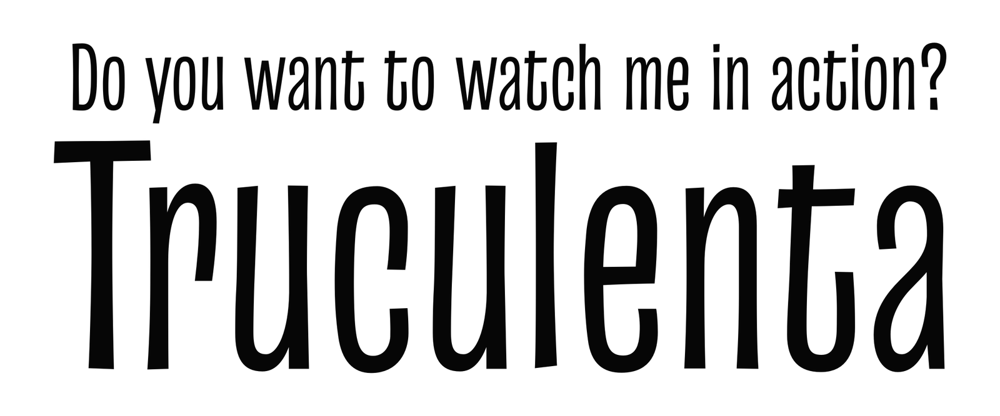
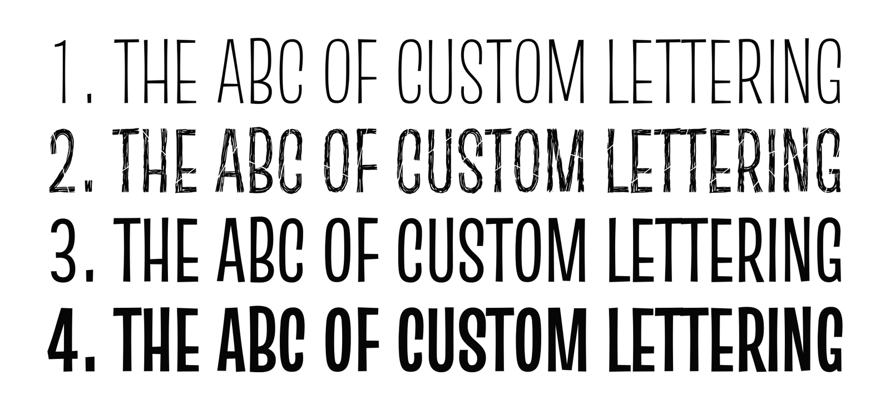
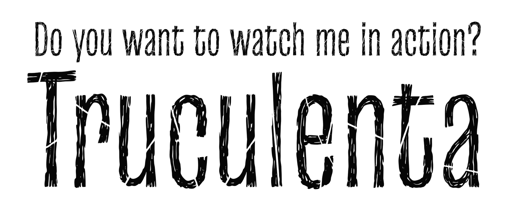
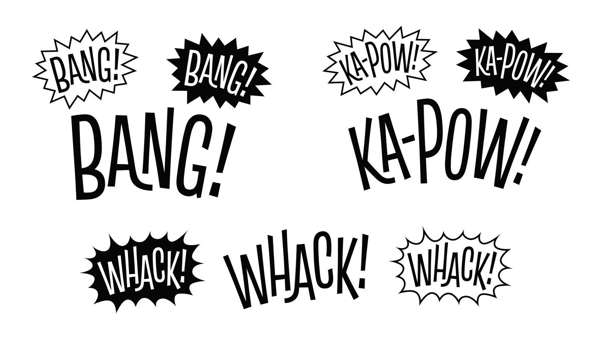
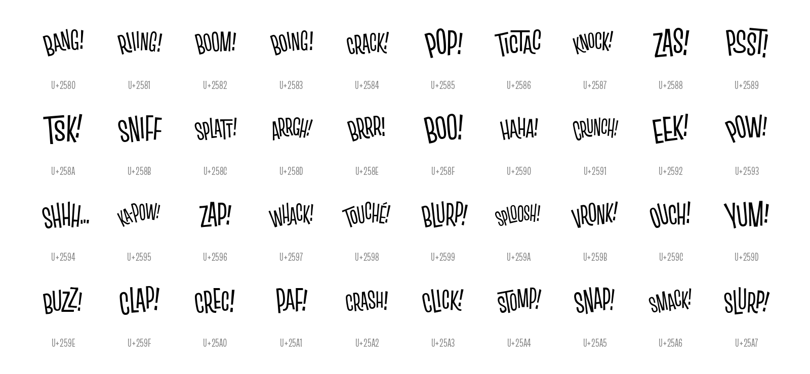
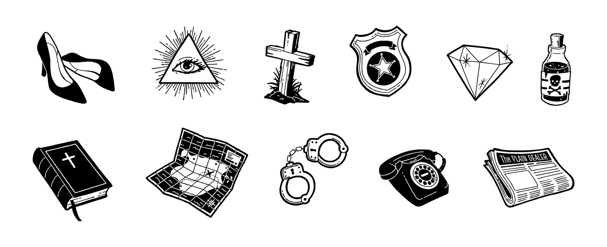
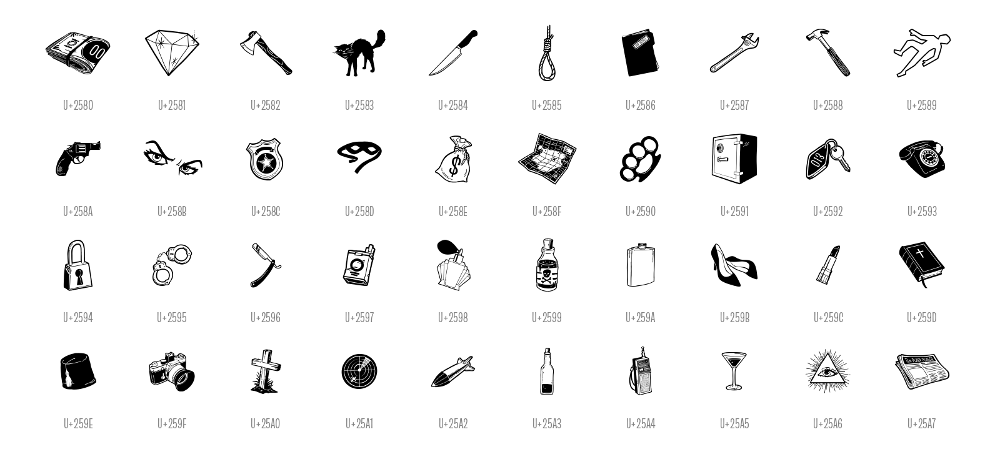

# Truculenta Original

**Iván Castro, Eva Sanz & Omnibus-Type Team**
*SIL Open Font License 1.1 · 4 fonts · 1,460 glyphs each*



Truculenta Original is an irregular sans serif typeface based on mid-century lettering works, yet with a little twist. It is a quirky grotesque whose personality may be more vibrant than the usual cold neo-grotesque, which makes it well suited to packaging, branding, book covers, illustrated editions and film titles.

It is the original version of [Truculenta](https://github.com/Omnibus-Type/Truculenta), the variable superfamily on Google Fonts: three weights plus a Dirty style, with 40 onomatopoeias and 40 pictograms built into the fonts.

## Styles



| Style | Weight (CSS) | Files |
|---|---|---|
| Thin | 100 | `TruculentaOriginal-Thin` |
| Regular | 400 | `TruculentaOriginal-Regular` |
| Bold | 700 | `TruculentaOriginal-Bold` |
| Dirty | 900 on omnibus-type.com | `TruculentaOriginal-Dirty` |

**Dirty** is a kind of ragged Regular.



## Onomatopoeias and pictograms

The same 40 characters, from **U+2580 to U+25A7** (Block Elements and Geometric Shapes), hold:

- **Onomatopoeias** in Thin, Regular and Bold: BANG!, BOOM!, KA-POW!, WHACK!, CRASH!…
- **Pictograms** in Dirty, drawn by Eva Sanz: a revolver, handcuffs, a badge, a safe, a newspaper…

Type the character (for example `▀`, U+2580) and switch the style to go from one to the other: `▀` is “BANG!” in Regular and a roll of banknotes in Dirty.



<details>
<summary><b>All 40 onomatopoeias (Thin, Regular, Bold)</b></summary>



</details>



<details>
<summary><b>All 40 pictograms (Dirty)</b></summary>



</details>

## OpenType features

- **135 ligatures:** 5 standard (`liga`: ff, fi, fl, ffi, ffl) and 130 discretionary ligatures for capital pairs (`dlig`).
- **Stylistic set** `ss01` (also in `salt`): alternate **a, f, g, r, t, y** (with their accented forms).
- **Figures:** lining and old-style (`lnum`, `onum`), tabular and proportional (`tnum`, `pnum`), slashed zero (`zero`).
- **Fractions** (`frac`), **superiors and inferiors** (`sups`, `subs`, `sinf`), **ordinals** (`ordn`) and case-sensitive forms (`case`).

## Files

| Folder | Use |
|---|---|
| `otf/` | Desktop (recommended) |
| `ttf/` | Desktop and apps |
| `woff2/` | Web |
| `Truculenta-Original_Specimen.pdf` | Two-page A3 specimen |

### Web use

```css
@font-face {
  font-family: 'Truculenta Original';
  src: url('TruculentaOriginal-Regular.woff2') format('woff2');
  font-weight: 400;
  font-style: normal;
  font-display: swap;
}
```

Repeat the rule for Thin (100), Bold (700) and Dirty (900, or as a separate family).

## Credits

- **Design:** Iván Castro, Eva Sanz & Omnibus-Type Team
- **Pictograms:** Eva Sanz
- **Contributors:** Yorlmar Campos, Pablo Cosgaya, Óscar Guerrero
- **Awards:** Sello de Buen Diseño 2020 · Tipos Latinos Biennial 2022

More about the typeface: [omnibus-type.com/fonts/truculenta-original](https://www.omnibus-type.com/fonts/truculenta-original/)

## License

Copyright © 2019 Iván Castro, Eva Sanz & Omnibus-Type Team.

Licensed under the [SIL Open Font License, Version 1.1](OFL.txt). You can use, study, modify and redistribute the fonts freely, including in commercial work, as long as they are not sold on their own.
